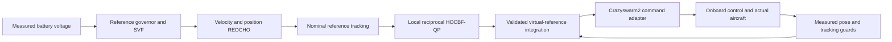

# Architecture

Three-aircraft dual-REDCHO/HOCBF-QP position control with a prechecked slow handover.

Motive → NatNet → motion_capture_tracking → `/poses` → Crazyswarm2 C++ server
→ Crazyradio → onboard estimator/controller. Pose/status returns to the host.

Each agent owns an SVF, a velocity REDCHO bank, a position/height REDCHO bank
and a local reciprocal HOCBF-QP. Measured battery voltage advances the local
reference phase; no simulated state-of-charge is substituted for voltage.
Two ring neighbors exchange same-cycle observer estimates. A coordinator sends
common virtual-reference state and voltages and accepts only complete command
batches. A separate watchdog monitors heartbeats and requests recovery.

The HOCBF acts on a virtual reference plant with inflated pair/arena/obstacle
allowances. Physical tracking is monitored separately. A safe virtual reference
does not establish arbitrary disturbed-aircraft safety. These hardware stacks
do not compute or send the four motor forces used in the simulation repository.

This edition sends position/yaw only. Velocity/acceleration remain computed reference quantities, not fields transmitted in Position messages. A geometrically checked slow bridge brings the planned takeoff hover to existing slots before REDCHO ALIGN begins; that bridge itself does not run the REDCHO/QP controller.

Diagnostics preserve source/receipt clocks and algorithm session/sequence where
available. Position messages do not encode algorithm sequence or onboard receipt.
Recorders must use the exact executed profile, including surveyed geometry.
