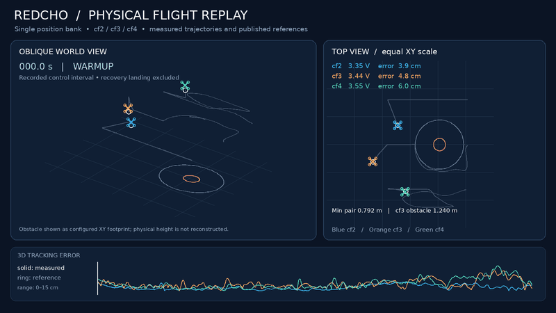

# Single-position hardware: real flight data replay

User-provided real flight data replay for **cf2, cf3 and cf4**, showing measured trajectories and published references. The recorded control interval is shown; **recovery landing is excluded**. The obstacle is displayed as its configured XY footprint; its physical height is not reconstructed.

The animation includes an oblique world view, an equal-scale XY top view,
per-aircraft voltage and tracking-error labels, pair/obstacle distances, and
a 3D tracking-error trace. Blue denotes cf2, orange cf3 and green cf4. As labeled
in the animation, solid markers represent measured positions and rings show
references. The GIF filename labels the preview as `4x` playback.

- [Download the original GIF](media/Flight_preview_4x.gif)
- [Asset metadata and SHA256](media/Flight_preview_4x.metadata.json)
- [Associated hardware release](https://github.com/khubaib007/Safe-Redcho-Crazyflies/releases/tag/single-position-v0.3.0)

The original file is preserved unchanged: 800 × 450 pixels, 216 frames and
21.6 seconds of GIF playback. It is a rendered telemetry replay, rather than
camera footage. The displayed interval does not establish the outcome of the
excluded recovery landing or a complete flight-validation result.

The controller source, parameters and existing release tag are unchanged by
this media/documentation addition.
