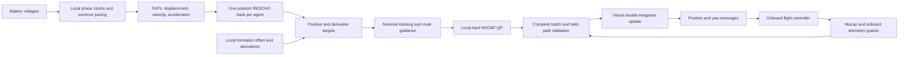

# Single-position REDCHO mission: mathematical formulation

This document describes the executable controller in `safe_redcho_single_mission`, including its reference generation, one position REDCHO bank per aircraft, formation tracking, hard HOCBF-QPs, numerical integration, communication and measured-state guards. It describes the implementation rather than asserting an ideal REDCHO or CBF theorem applies automatically to the sampled hardware system. The combined-profile values below were read from `config/single_mission_combined.yaml` on 4 November 2026. Captured experiment profiles can contain different measured starts, obstacle coordinates and takeoff height proposals.

The flight-control model is a **virtual reference double integrator**. The Crazyflie receives position and yaw messages and tracks them with its onboard controller. Its physical position is not assumed to equal the virtual reference. This distinction determines what the HOCBF constraints establish and where measured hardware guards are needed.

## 1. Variables, coordinates and system structure

There are three agents, indexed by

\[
\mathcal V=\{1,2,3\}\quad\leftrightarrow\quad\{\texttt{cf2},\texttt{cf3},\texttt{cf4}\}.
\]

All positions use the mocap `world` frame. Superscript `xy` denotes the first two components. Euclidean norm is written \(\|\cdot\|\), while \(\|\cdot\|_\infty\) is the largest absolute component.

| Symbol | Meaning | Units |
|---|---|---|
| \(p_i,\dot p_i\) | Measured mocap position and its fitted velocity | m, m/s |
| \(p_i^{\mathrm{on}},Q_i^{\mathrm{on}}\) | Onboard estimator position and attitude quaternion | m, unit quaternion |
| \(q_i,v_i\) | Virtual reference position and velocity | m, m/s |
| \(u_i\) | Accepted virtual acceleration, the QP decision | m/s² |
| \(u_i^-\) | Previous accepted acceleration | m/s² |
| \(V_i\) | Latest accepted battery voltage | V |
| \(r_i^{(0)},r_i^{(1)},r_i^{(2)}\) | Local center/height proposal and filtered derivative channels entering REDCHO | m, m/s, m/s² |
| \(y_i^{(0)},y_i^{(1)},y_i^{(2)}\) | Single REDCHO bank outputs | m, m/s, m/s² |
| \(\rho_i,\dot\rho_i,\ddot\rho_i\) | Local formation offset and its derivative channels | m, m/s, m/s² |
| \(p_i^d,v_i^d,a_i^d\) | Nominal formation tracking target and derivatives | m, m/s, m/s² |
| \(\Delta\) | Fixed logical integration period | s |
| \(\eta_k\) | Common reference-progress multiplier for cycle \(k\) | dimensionless |

Each aircraft has one ROS agent process. That process owns one REDCHO bank and solves one three-variable acceleration QP. The coordinator supplies a common-cycle state snapshot, waits for all three results, verifies their joint compatibility, integrates the virtual references and publishes position/yaw commands. This is decentralized estimation and local optimization with a coordinating communication/validation layer; it is not a system with completely independent state acquisition and command execution at every node.

The arrow from telemetry guards to validation represents acceptance/recovery logic. The nominal feedback law below uses \(q_i,v_i\), not measured \(p_i,\dot p_i\). Measured errors supervise the reference-following assumption.

## 2. Captured starts, hover locations and formation goals

Let \(g_i\) be the captured floor position. Given the configured individual takeoff height above the calibrated floor \(z_f\), the planned hover is

\[
h_i=\begin{bmatrix}g_{i,x}&g_{i,y}&z_f+H_i\end{bmatrix}^{\!T}.
\]

The initial hover center, desired formation center and its translation are

\[
c_0=\frac13\sum_i h_i,\qquad
c_* = \begin{bmatrix}c_{*,x}&c_{*,y}&c_{0,z}\end{bmatrix}^{\!T},\qquad
\delta=c_*-c_0.
\]

The offsets assigned to aircraft are \(\rho_i^1\), satisfying

\[
\sum_i\rho_i^1=0,\qquad \rho_{i,z}^1=0.
\]

`fixed_names` preserves the configured aircraft-to-slot mapping. `sorted_y` instead matches the ordering of captured aircraft along \(y\) to the ordering of the target offsets. The current combined profile uses `fixed_names`; consequently, an aircraft's target can lie across another aircraft's direct route. Crossing direct routes are not themselves invalid if a feasible, collision-free detour exists.

The initial horizontal offsets and final formation endpoints are

\[
\rho_i^0=(h_i-c_0)\quad\text{with its }z\text{ component set to zero},
\qquad p_i^{\mathrm{goal}}=c_*+\rho_i^1.
\]

The transported endpoint is \(p_i^{\mathrm{goal}}+D e_x\), with configured forward distance \(D\). Starts, hover locations and both endpoint sets must lie inside the inflated reference volume and outside inflated obstacles, and must have the required horizontal pair separation. Checking endpoints alone does not establish route feasibility.

After physical takeoff settles, the local proposal's height is replaced with that aircraft's measured settled height, and \(c_{*,z}\) is replaced with the mean of those three measured heights. The horizontal proposal remains the planned hover position. This lets the position REDCHO bank establish a common measured initial height proposal without assuming identical takeoff tracking.

The source profile, captured starts and immutable experiment profile have SHA-256 identities. A changed configuration or changed capture invalidates the associated survey. This prevents different agent processes silently using different obstacle geometry or mission settings; it does not validate the physical geometry by itself.

## 3. Battery-dependent phase clocks

With landing voltage \(V_{\mathrm{land}}\), full-speed voltage \(V_{\mathrm{full}}\) and minimum scale \(s_{\min}\), each local battery speed scale is

\[
s_i(k)=\operatorname{clip}\!\left(
\frac{V_i(k)-V_{\mathrm{land}}}{V_{\mathrm{full}}-V_{\mathrm{land}}},\ s_{\min},\ 1\right).
\]

The reference generator rejects missing/nonfinite voltages, voltages at or below \(V_{\mathrm{land}}\), and voltages above 4.5 V. Live ground checks separately require the higher ground-voltage threshold. This mapping is a battery-aware **progress policy**, not a battery state-of-charge estimator, remaining-energy model or proof of energy-optimal allocation. In particular, clipping makes all voltages at or above \(V_{\mathrm{full}}\) produce scale one.

Let \(\eta_k\in[0,1]\) be a common next-cycle pacing factor. The local acquisition clock \(\sigma_i\), forward clock \(\phi_i\) and common-shape clock \(\chi_i\) update only in their corresponding stages:

\[
\begin{aligned}
\sigma_i^+&=\min\left(1,\sigma_i+\frac{\Delta}{T_A}s_i\eta_k\right)
&&\text{during FORMATION},\\
\phi_i^+&=\min\left(1,\phi_i+\frac{\Delta}{T_F}s_i\eta_k\right)
&&\text{during FORWARD},\\
\chi_i^+&=\min\left(1,\chi_i+\frac{\Delta}{T_A}\min_j(s_j)\eta_k\right)
&&\text{during FORMATION}.
\end{aligned}
\]

Outside the specified stage each clock holds its value. All agents receive the same voltage vector and common \(\eta_k\), so their shape clocks remain equal when initialized equally. The center clocks can differ because they use each aircraft's own battery scale. Their resulting local center proposals are the signals averaged by REDCHO.

Define the quintic easing polynomial

\[
S(s)=10s^3-15s^4+6s^5,\qquad 0\le s\le1,
\]

with \(S(0)=0,S(1)=1,S'(0)=S'(1)=S''(0)=S''(1)=0\). Its peak derivative is 1.875. The discrete raw acquisition and forward velocities are **increments divided by the sample period**, rather than an evaluation of \(S'\) at a point:

\[
b_{A,i,k}=\delta\frac{S(\sigma_i^+)-S(\sigma_i)}{\Delta},
\qquad
b_{F,i,k}=D e_x\frac{S(\phi_i^+)-S(\phi_i)}{\Delta}.
\]

Each is zero outside its active stage. Similarly, the scalar shape input is

\[
b_{\rho,k}=\frac{S(\chi_i^+)-S(\chi_i)}{\Delta}
\]

during FORMATION, and zero otherwise. Its units are s⁻¹. Local center and shape phases are not reset when a conflict causes slower progress.

The plan validator uses \(1.875\|\delta\|/T_A\le0.8v_{\max}\) for the acquisition-center speed budget and \(1.875D/T_F\le v_{\max}\) for the nominal forward peak. These are input-shape screening conditions. The actual accepted command is still bounded by the QP.

## 4. SVF dynamics and where integration actually occurs

There are three state-variable filters per agent: acquisition translation, forward translation and scalar shape progression. These filters are not additional REDCHO consensus banks.

For any component with raw input \(b(t)\), the continuous filter model has four states:

\[
\begin{aligned}
\dot z_0&=z_1,\\
\dot z_1&=z_2,\\
\dot z_2&=z_3,\\
\dot z_3&=-\omega^3(z_1-b)-3\omega^2z_2-3\omega z_3.
\end{aligned}
\tag{1}
\]

For center motion, \(z_0,z_1,z_2,z_3\) represent displacement, velocity, acceleration and jerk. With zero initial conditions, the ideal transfer functions are

\[
\frac{Z_1(s)}{B(s)}=\frac{\omega^3}{(s+\omega)^3},\qquad
\frac{Z_0(s)}{B(s)}=\frac{\omega^3}{s(s+\omega)^3}.
\]

Thus the filtered velocity is integrated inside the SVF to form displacement. Battery voltage changes the phase speed of \(b\); it does not directly represent a position. This architecture uses both integration and dynamic consensus, for different purposes.

The code advances (1) with an explicit midpoint/RK2 step while keeping the current raw input constant within that step:

\[
z_{k+1}=z_k+\Delta f\left(z_k+\frac{\Delta}{2}f(z_k;b_k);b_k\right).
\tag{2}
\]

All filters continue updating with zero input after their phase finishes, allowing their derivative channels to settle. A completed phase is therefore not the same event as measured endpoint convergence.

Let \(z_{A,i}\) and \(z_{F,i}\) denote the two translation filters and define

\[
d_i^{(\mu)}=z_{A,i,\mu}+z_{F,i,\mu},\qquad \mu=0,1,2,3.
\]

For initial local absolute proposal \(a_i\), the REDCHO input is

\[
r_i^{(0)}=a_i+d_i^{(0)},\qquad
r_i^{(1)}=d_i^{(1)},\qquad
r_i^{(2)}=d_i^{(2)}.
\tag{3}
\]

The input is an **absolute world center/height proposal**, with dimensions matching position and derivatives. It is not the formation offset and is not a battery-voltage signal. Horizontal offsets are added after consensus in Section 7.

The implementation also checks a REDCHO regularity budget. Define

\[
\prod_{\ell=0}^2(s+\gamma_\ell)=s^3+c_2s^2+c_1s+c_0.
\]

Then the monitored quantity is

\[
\left\|d_i^{(3)}+c_0r_i^{(0)}+c_1r_i^{(1)}+c_2r_i^{(2)}\right\|\le L_p/2.
\tag{4}
\]

The current values give \((c_0,c_1,c_2)=(0.003375,0.0675,0.45)\) and threshold 16 in the implementation's configured signal normalization. (4) is an executable guard, not a substitute for proving a theoretical regularity assumption over every admissible experiment. In particular, \(L_p\) and the smoothed nonlinear injection below must be interpreted with the selected signal units/scaling; they are not a physical acceleration limit.

## 5. The sole order-2 position REDCHO bank

The order is two because outputs of orders zero, one and two are reconstructed. Each agent stores a \(3\times3\) matrix \(X_i\): three spatial axes times three internal orders, or **nine scalar internal states**.

For one spatial coordinate, write its column of internal states as \(x_i=(x_{i0},x_{i1},x_{i2})^T\). Define

\[
A_\gamma=\begin{bmatrix}
-\gamma_0&1&0\\
0&-\gamma_1&1\\
0&0&-\gamma_2
\end{bmatrix},\qquad C=\begin{bmatrix}1&0&0\end{bmatrix},
\]

\[
G=\begin{bmatrix}C\\CA_\gamma\\CA_\gamma^2\end{bmatrix}
=\begin{bmatrix}
1&0&0\\
-\gamma_0&1&0\\
\gamma_0^2&-(\gamma_0+\gamma_1)&1
\end{bmatrix}.
\tag{5}
\]

The three output channels for that coordinate are computed before the internal-state update:

\[
\begin{bmatrix}y_i^{(0)}\\y_i^{(1)}\\y_i^{(2)}\end{bmatrix}
=\begin{bmatrix}r_i^{(0)}\\r_i^{(1)}\\r_i^{(2)}\end{bmatrix}-Gx_i.
\tag{6}
\]

Across all spatial axes, this is `Y = reference - (G @ X.T).T`. The state starts at zero. In the first cycle each local estimate equals its own local proposal, rather than already equaling the network mean.

Every agent receives both other agents' same-cycle zeroth-order outputs \(y_j^{(0)}\). For three agents this undirected ring is also the complete graph; it should not be described as an experimentally demonstrated sparse-ring result for arbitrary swarm size.

Let \(e_{ij}=y_i^{(0)}-y_j^{(0)}\), applied separately to each coordinate. For \(\mu=0,1,2\), define

\[
\alpha_\mu=\frac{2-\mu}{3},\qquad
\beta_\mu=\frac{\mu+1}{3},\qquad
\Phi_{\alpha,\epsilon}(e)=e(e^2+\epsilon^2)^{(\alpha-1)/2}.
\tag{7}
\]

This is a smooth signed-power approximation. At finite \(\epsilon\), especially for \(\alpha_2=0\), it is not the discontinuous sign-power law used in an ideal finite-time analysis.

The injected term is

\[
I_{i\mu}=\sum_{j\in\mathcal N_i}
k_\mu\theta^{\mu+1}L_p^{\beta_\mu}
\Phi_{\alpha_\mu,\epsilon}(e_{ij}).
\tag{8}
\]

The continuous state expression implemented by `local_derivative` is

\[
\begin{aligned}
\dot x_{i0}&=-\gamma_0x_{i0}+x_{i1}+I_{i0},\\
\dot x_{i1}&=-\gamma_1x_{i1}+x_{i2}+I_{i1},\\
\dot x_{i2}&=-\gamma_2x_{i2}+I_{i2}.
\end{aligned}
\tag{9}
\]

The actual numerical update is explicit Euler:

\[
x_{i,k+1}=x_{i,k}+\Delta\,\big(A_\gamma x_{i,k}+I_{i,k}\big).
\tag{10}
\]

The controller uses the prepared \(Y_{i,k}\) from (6), not a recomputed \(Y_{i,k+1}\) after (10). This ordering matters in an exact replay.

### 5.1 What position consensus estimates

The intended outputs are the network averages

\[
\bar r^{(\mu)}=\frac13\sum_jr_j^{(\mu)},\qquad
y_i^{(\mu)}\approx\bar r^{(\mu)},\quad \mu=0,1,2.
\tag{11}
\]

The position channel estimates the common center and height, while its derivative channels provide the common translational velocity and acceleration. There is no separately estimated battery-driven velocity bank.

There is a useful algebraic average-preservation property: \(\Phi\) is odd, paired undirected edges use equal gains and the same-cycle outputs, so \(\sum_iI_{i\mu}=0\). With \(\sum_ix_i(0)=0\), (9) and (10) preserve \(\sum_ix_i=0\) in exact arithmetic. Consequently,

\[
\frac13\sum_i y_i^{(\mu)}=\frac13\sum_i r_i^{(\mu)}.
\tag{12}
\]

(12) does **not** imply each individual \(y_i\) equals the average. Agreement is a separate convergence question. Smooth injection, finite precision, Euler discretization and communication timing mean ideal continuous nonsmooth REDCHO convergence claims cannot simply be copied into a hardware theorem. The mission explicitly measures agreement and reconstruction error before advancing.

### 5.2 Derivative channels are estimates, not exact kinematic identities

Sharing one bank does not make its transient derivative channels exactly equal the time derivatives of its position channel. For one coordinate, if the input derivative channels are exact continuous derivatives, (6)–(9) give

\[
\dot y_i^{(0)}=y_i^{(1)}-I_{i0},\qquad
\dot y_i^{(1)}=y_i^{(2)}+\gamma_0I_{i0}-I_{i1}.
\tag{12a}
\]

The injection terms explicitly correct the estimate while consensus develops. Finite-step RK2/Euler adds numerical differences as well. The intended result is that all three channels reconstruct the corresponding average position/derivatives with small error, rather than that local channel identities hold exactly throughout acquisition. This is why the measured agreement/reconstruction gates and constrained downstream reference plant remain necessary. The phrase “one common source of position and derivative estimates” is more precise than claiming exact derivative consistency during every transient.

## 6. Formation-shape trajectory

Let \(\beta,\dot\beta,\ddot\beta\) be the first three states of the scalar shape SVF driven by \(b_\rho\). Define \(\Delta\rho_i=\rho_i^1-\rho_i^0\). The local offset channels are

\[
\rho_i=\rho_i^0+\Delta\rho_i\beta,\qquad
\dot\rho_i=\Delta\rho_i\dot\beta,\qquad
\ddot\rho_i=\Delta\rho_i\ddot\beta.
\tag{13}
\]

These local shape signals are added after center consensus; averaging the offsets into a common offset would destroy the formation geometry. With equal shape states and centered initial/final offsets, \(\sum_i\rho_i=0\).

Even though \(\chi\) saturates at one, the filtered \(\beta\) has a tail and reaches its final value asymptotically. The measured settle conditions, rather than a clock alone, decide whether acquisition succeeded.

The formation has zero desired vertical offsets. Different initial takeoff heights are brought to the same REDCHO-averaged height in the HEIGHT stage. Pair avoidance remains horizontal at every height; vertical separation is not used to permit smaller XY distances or to fly an aircraft over another.

## 7. Stage-dependent tracking targets

All stages start from planned individual hover position \(h_i\) with zero desired velocity and acceleration. The following overrides are then applied:

| Stage | Horizontal target | Vertical target |
|---|---|---|
| WARMUP | \(p_i^{d,xy}=h_i^{xy},\ v_i^{d,xy}=a_i^{d,xy}=0\) | \(p_{i,z}^d=h_{i,z},\ v_{i,z}^d=a_{i,z}^d=0\) |
| HEIGHT, YAW | Hold hover XY | \((p_{i,z}^d,v_{i,z}^d,a_{i,z}^d)=(y_{i,z}^{(0)},y_{i,z}^{(1)},y_{i,z}^{(2)})\) |
| FORMATION, SETTLE, FORWARD, STOP | \((p_i^{d,xy},v_i^{d,xy},a_i^{d,xy})=(y_i^{(0),xy}+\rho_i^{xy},\ y_i^{(1),xy}+\dot\rho_i^{xy},\ y_i^{(2),xy}+\ddot\rho_i^{xy})\) | Same REDCHO height channels |

At the start, REDCHO can converge while aircraft hold their individual hover positions. Common height is established before yaw alignment and horizontal formation acquisition. Once common-center estimates agree, the different offsets place the aircraft in different slots around that center.

After the phases and filter transients settle, the intended targets are

\[
p_i^d\longrightarrow c_*+\rho_i^1
\]

after acquisition, and

\[
p_i^d\longrightarrow c_*+D e_x+\rho_i^1
\]

after forward transport. Completion still depends on measured endpoint, speed, height and heading checks.

## 8. Nominal virtual tracking law

Before avoidance guidance, each agent computes

\[
u_i^{\mathrm{track}}=a_i^d+K_p(p_i^d-q_i)+K_v(v_i^d-v_i),
\tag{14}
\]

with scalar gains \(K_p=1.2\ \mathrm{s}^{-2}\), \(K_v=2.2\ \mathrm{s}^{-1}\), applied to all three axes. For the ideal continuous double integrator with exact derivative-consistent targets and no QP changes, the tracking error \(e_i=q_i-p_i^d\) obeys

\[
\ddot e_i+K_v\dot e_i+K_pe_i=0.
\]

This identity motivates the nominal controller only. In execution, REDCHO outputs are sampled estimates, guidance changes the nominal input, the previous-command objective smooths it, hard constraints can intervene, and the physical vehicle follows a position controller. A physical tracking theorem does not follow from this nominal second-order equation.

## 9. Route guidance and common pacing

Guidance operates in FORMATION, SETTLE, FORWARD and STOP. It changes the nominal tracking command upstream of the hard QP; it changes neither safety radii nor barrier rows. The current enhanced profiles enable visibility-waypoint guidance, with the existing local circulation retained as a fallback when the geometric route search cannot produce a path.

### 9.1 Receding geometric visibility routes

At one geometric snapshot, treat each other aircraft's current virtual XY position as the center of a disk of radius \(d_{\mathrm{ref}}\), and each surveyed cylinder as a disk of radius \(R_o\). Denote this set \(\{(c_h,R_h)\}\). This frozen-peer assumption is used only to choose a nominal route. The current-state HOCBF rows still use actual common-cycle relative velocities, authority bounds and uncertainty reserves, and are rebuilt every cycle.

For own start \(s=q_i^{xy}\) and the **current stage-dependent REDCHO target** \(g=p_i^{d,xy}\), the point-to-segment distance is evaluated exactly:

\[
\tau_h=\operatorname{clip}\left(\frac{(c_h-s)^T(g-s)}{\max(\|g-s\|^2,10^{-15})},0,1\right),\qquad
d_h(s,g)=\|s+\tau_h(g-s)-c_h\|.
\tag{15a}
\]

If the target is strictly inside the reference box and the complete direct segment satisfies \(d_h(s,g)\ge R_h+\min(0.015,m_r)\) for every hazard, route guidance releases immediately and the original nominal acceleration (14) is used. Its transition is still limited by the ordinary/hard QP slew policy. This direct-segment release check is stronger than declaring a route clear from a closest-approach velocity prediction alone.

If the segment is blocked, construct a finite visibility graph. An optional planning clearance tapers near tight endpoints:

\[
e_h=\max\left(0,\min\left(m_r,\ 0.4(\|s-c_h\|-R_h),\ 0.4(\|g-c_h\|-R_h)\right)\right),
\qquad \widetilde R_h=R_h+e_h.
\tag{15b}
\]

The maximum extra planning margin \(m_r=0.025\) m never reduces a hard radius. A genuinely occupied goal remains occupied: no positive route is manufactured by shrinking the obstacle or pair disk.

The graph contains \(s,g\) and up to \(M=24\) equally spaced samples around each disk:

\[
w_{h,n}=c_h+\left(\frac{\widetilde R_h}{\cos(\pi/M)}+0.002\right)
\begin{bmatrix}\cos(2\pi n/M)\\\sin(2\pi n/M)\end{bmatrix},\qquad n=0,\ldots,M-1.
\tag{15c}
\]

The circumscribed radius makes neighboring ring chords remain outside their own disk. Candidate interior waypoints must also be outside every other inflated disk and inside the reference box with an extra 0.012 m planning wall margin. Valid tight start/goal endpoints need not satisfy this optional extra wall margin, but must still satisfy the hard reference arena bounds. A maximum-node budget of 256 bounds the geometric search; too many hazards cause an explicit blocked result.

For every candidate graph edge \((w_a,w_b)\), apply (15a) to every disk and retain the edge only if its full closed segment is clear of all \(\widetilde R_h\), within the small numeric geometric tolerance. The rectangle is convex, so a segment connecting valid box points remains inside it. Edges are weighted by Euclidean length. Dijkstra's algorithm returns the shortest path **in this finite snapshot graph**:

\[
\min_{\pi:s\leadsto g}\sum_{(a,b)\in\pi}\|w_b-w_a\|.
\tag{15d}
\]

This is not a proof of shortest-path optimality in the continuous moving-agent environment, and finite ring sampling can miss a physically possible narrow route.

Waypoints are cached for up to 0.5 s of logical time. A target displacement above 0.10 m forces an earlier replan. A nonfinal waypoint is consumed when its distance is below 0.08 m. The selected next waypoint \(w_i\) yields

\[
v_i^{\mathrm{route}}=\operatorname{sat}_{v_{\mathrm{pass}}}\big(k_r^{\mathrm{route}}(w_i-q_i^{xy})\big),\qquad
k_r^{\mathrm{route}}=1.1\ \mathrm{s}^{-1},\quad v_{\mathrm{pass}}=0.13\ \mathrm{m/s},
\]

\[
u_i^{\mathrm{nom},xy}=K_v(v_i^{\mathrm{route}}-v_i^{xy}),\qquad
u_{i,z}^{\mathrm{nom}}=u_{i,z}^{\mathrm{track}}.
\tag{15e}
\]

The route branch fully replaces the XY nominal with this velocity-servo preference while active, and reports active guidance for the pacing rule below. It preserves the single REDCHO bank, its state, SVF integrators and assigned formation goals. Routing uses the actual target during FORWARD and STOP as well as acquisition; it does not continue pulling an aircraft toward an obsolete acquisition endpoint.

The circulation fallback's encounter, passing-side, blend and stall context is retained across temporary waypoint/direct-tracking handoffs. Resetting that context could restart a partially completed pass in an unfavorable direction near a wall; the recorded 18:27:07 preview is a regression for this transition. This is continuity of guidance memory, not a persistent constraint on the QP.

Between replans, cached waypoints can become geometrically stale as peers move. They are not treated as certificates: the fresh hard QP and complete held-path checks can override the nominal route every cycle. If the geometric goal is occupied, the node budget is exhausted or no graph path exists, the original circulation fallback below is used. If the hard feasible acceleration set is empty, neither routing layer authorizes a violating command. Abort/recovery remains the final response.

### 9.2 Local passing fallback

The circulation fallback observes virtual XY speed below 0.035 m/s and XY target error above 0.10 m for 0.6 s, or continues a previously active encounter. The visibility-route branch above can therefore act before a prolonged stall, while this older mechanism is retained for cases such as a currently occupied moving goal.

With relative position \(r\), relative candidate velocity \(w\), and lookahead \(T_\ell\), closest linear approach is

\[
t_* =\operatorname{clip}\left(-\frac{r^Tw}{\max(w^Tw,10^{-12})},0,T_\ell\right),\qquad
d_* =\|r+t_*w\|.
\tag{15}
\]

The guide identifies a prospective pair/cylinder encounter when \(d_*\) is below its inflated radius plus an activation margin. A larger release margin provides hysteresis. A consistent pair chirality is chosen from common captured geometry and final goals, with arena, cylinder and third-aircraft clearance preferences. Side selection is latched rather than recomputed arbitrarily on each noisy frame.

For selected hazard outward unit normal \(n\), a side \(\varsigma\in\{-1,+1\}\) gives tangent

\[
t=\varsigma\begin{bmatrix}-n_y\\n_x\end{bmatrix}.
\]

The guided XY velocity is a norm-limited sum of tangent motion and nonnegative outward correction:

\[
w_i^g=\operatorname{sat}_{v_{\mathrm{pass}}}
\left(v_{\mathrm{pass}}t+n\operatorname{clip}\left(k_r(R+m_o-\|r\|),0,\tfrac12v_{\mathrm{pass}}\right)\right).
\tag{16}
\]

The circulation velocity is not offset by the neighbor's translational velocity. The guide blends the original XY nominal acceleration with a velocity-servo acceleration:

\[
\ell_{k+1}=\ell_k+\frac{\Delta}{T_b+\Delta}(\ell_k^*-\ell_k),\qquad
u_i^{\mathrm{nom},xy}=(1-\ell)u_i^{\mathrm{track},xy}+\ell K_v(w_i^g-v_i^{xy}).
\tag{17}
\]

Here \(\ell^*=1\) when guidance is active and zero otherwise. The Z nominal remains unchanged. All guided accelerations go through the same hard QP. A chosen passing side is a **soft route preference**, not a safety guarantee. A safety filter by itself can brake or stop a conflict without selecting a useful detour.

### 9.3 Common next-cycle progress

Each result reports target lag \(L_i=\|p_i^d-q_i\|\) and whether passing is active. For inactive guidance, let

\[
f_i=1-(1-\eta_{\min})\operatorname{clip}
\left(\frac{L_i-L_{\mathrm{slow}}}{L_{\mathrm{stop}}-L_{\mathrm{slow}}},0,1\right).
\]

For active guidance set \(f_i=\eta_{\mathrm{pass}}\). The coordinator uses

\[
\eta_{k+1}=\min_i f_i.
\tag{18}
\]

The current defaults are \(L_{\mathrm{slow}}=0.12\) m, \(L_{\mathrm{stop}}=0.30\) m, \(\eta_{\min}=0.1\), \(\eta_{\mathrm{pass}}=0.65\). In this implementation the active-guidance branch uses its assigned factor directly instead of also applying the inactive-lag formula. Pacing slows reference clocks; it does not directly stop the physical drone or reset its SVF/REDCHO state.

## 10. Virtual reference plant and command timing

The model filtered by the QP is

\[
\dot q_i=v_i,\qquad \dot v_i=u_i.
\tag{19}
\]

For a constant acceleration over one logical interval, its exact update is

\[
q_{i,k+1}=q_{i,k}+\Delta v_{i,k}+\tfrac12\Delta^2u_{i,k},\qquad
v_{i,k+1}=v_{i,k}+\Delta u_{i,k}.
\tag{20}
\]

The coordinator publishes \(q_{i,k+1}\) and the stage yaw reference. `cmd_position` does **not** send the recorded \(v_i,u_i\) as velocity/acceleration feedforward to firmware. They are virtual trajectory derivatives and journal fields.

Logical \(\Delta=0.02\) s remains fixed even when a real cycle takes longer. The launcher enforces wall-clock publication-gap and complete-cycle deadlines but does not make wall time equal logical time. Therefore a proof based on exact 50 Hz execution would need additional timing assumptions. Three position messages are published sequentially; complete-batch acceptance prevents knowingly applying only a solved subset, but it is not an atomic radio multicast and does not prove simultaneous onboard receipt.

## 11. Inflated safety geometry

### 11.1 Pair radius

The required virtual horizontal center distance is

\[
d_{\mathrm{ref}}=d_{\mathrm{phys}}+2e_t+2e_m+r_{\mathrm{pair}},
\tag{21}
\]

where \(e_t\) is tracking-tube radius, \(e_m\) mocap-position uncertainty and \(r_{\mathrm{pair}}\) an extra pair reserve. The current combined values give

\[
d_{\mathrm{ref}}=0.4+2(0.12)+2(0.009)+0.06=0.718\ \mathrm m.
\]

If each true physical position stays within the assumed tracking/measurement tube, triangle inequalities relate virtual separation to physical separation. This implication is conditional on those bounds holding continuously. Sampling a measured tracking guard cannot prove that nothing happened between measurement timestamps.

### 11.2 Reference box

Let body radius \(r_b\), wall-surface clearance \(c_w\), wall reserve \(r_w\), physical room bounds \([x_-,x_+]\times[y_-,y_+]\), ceiling \(z_c\), ceiling clearance \(c_c\), and minimum airborne height \(H_{\min}\). Define

\[
e_w=r_b+c_w+e_t+e_m+r_w,
\]

\[
\underline q=\begin{bmatrix}x_-+e_w\\y_-+e_w\\z_f+H_{\min}\end{bmatrix},\qquad
\overline q=\begin{bmatrix}x_+-e_w\\y_+-e_w\\z_c-c_c-e_t-e_m-r_w\end{bmatrix}.
\tag{22}
\]

For the combined profile, \(e_w=0.359\) m, XY bounds are \([-1.141,1.141]\) m and Z bounds are \([0.2798,0.941]\) m. The lower Z formula is intentionally the implementation's airborne-height floor; it does not symmetrically add every upper-ceiling reserve.

### 11.3 Static cylinders

For obstacle \(o\) with center \(c_o\), measured footprint radius \(r_o\), requested surface clearance \(c_o^s\) and obstacle-center uncertainty \(e_o\), its reference radius is

\[
R_o=r_o+c_o^s+r_b+e_m+e_o+e_t+r_w.
\tag{23}
\]

The combined cylinder gives \(R_o=0.439\) m. Its measured abort center-distance threshold omits \(e_t+r_w\), giving 0.289 m. The model is a static upright cylinder for XY avoidance at every flight height. Obstacle pivot-height/tilt/center guards detect movement or invalid geometry; the controller does not infer an overflight corridor from finite obstacle height.

## 12. Continuous HOCBF construction

For any relative-degree-two geometric barrier \(h\), define

\[
\psi_0=h,\qquad \psi_1=\dot h+\kappa_1h,
\]

and require

\[
\dot\psi_1+\kappa_2\psi_1
=\ddot h+(\kappa_1+\kappa_2)\dot h+\kappa_1\kappa_2h\ge0.
\tag{24}
\]

Both \(\kappa_1,\kappa_2>0\), currently 2 s⁻¹. They determine barrier response, not a separate physical acceleration authority. The familiar continuous-time forward-invariance argument assumes admissible initialization \(h\ge0,\psi_1\ge0\), sufficiently regular dynamics, enforced inequalities over time and a feasible controller. The implementation additionally checks sampled/held behavior, but does not establish recursive feasibility for arbitrary future interactions.

### 12.1 Interagent HOCBF

For pair \(i,j\), use horizontal quantities

\[
r_{ij}=q_i^{xy}-q_j^{xy},\qquad
w_{ij}=v_i^{xy}-v_j^{xy},\qquad
h_{ij}=r_{ij}^Tr_{ij}-d_{\mathrm{ref}}^2.
\]

Then

\[
\dot h_{ij}=2r_{ij}^Tw_{ij},\qquad
\ddot h_{ij}=2w_{ij}^Tw_{ij}+2r_{ij}^T(u_i^{xy}-u_j^{xy}).
\]

Let each virtual acceleration error have norm at most \(\delta_a\). The worst loss in \(\ddot h\) is bounded by \(4\|r_{ij}\|\delta_a\). Thus define

\[
B_{ij}=2\|w_{ij}\|^2+(\kappa_1+\kappa_2)2r_{ij}^Tw_{ij}
+\kappa_1\kappa_2h_{ij}-4\|r_{ij}\|\delta_a.
\]

The robust joint row is

\[
-2r_{ij}^Tu_i^{xy}+2r_{ij}^Tu_j^{xy}\le B_{ij}.
\tag{25}
\]

Its unnormalized RHS has units m²/s². \(\delta_a=0.03\) m/s² is a configured virtual-model uncertainty assumption. It is not an online estimate of arbitrary aerodynamic disturbance.

### 12.2 Static cylinder HOCBF

For \(r=q_i^{xy}-c_o\), \(w=v_i^{xy}\), \(h=r^Tr-R_o^2\), obstacle acceleration and velocity are zero. The robust row is

\[
-2r^Tu_i^{xy}\le
2\|w\|^2+(\kappa_1+\kappa_2)2r^Tw+\kappa_1\kappa_2h
-2\|r\|\delta_a.
\tag{26}
\]

The factor is two rather than four because only one modeled agent has acceleration uncertainty relative to the static center.

### 12.3 Box HOCBFs

For coordinate \(a\in\{x,y,z\}\), upper and lower barriers are

\[
h_{i,a}^+=\overline q_a-q_{i,a},\qquad h_{i,a}^-=q_{i,a}-\underline q_a.
\]

The robust acceleration rows are

\[
u_{i,a}\le-(\kappa_1+\kappa_2)v_{i,a}
+\kappa_1\kappa_2(\overline q_a-q_{i,a})-\delta_a,
\tag{27}
\]

\[
-u_{i,a}\le(\kappa_1+\kappa_2)v_{i,a}
+\kappa_1\kappa_2(q_{i,a}-\underline q_a)-\delta_a.
\tag{28}
\]

Box \(h\) has units m and \(\psi_1\) m/s. Pair/cylinder \(h\) has units m² and \(\psi_1\) m²/s. A common numeric tolerance must be interpreted in each native row's units.

## 13. Reciprocal distribution of pair responsibility

Each joint pair condition has the form

\[
a_i^Tu_i+a_j^Tu_j\le B,\qquad a_j=-a_i.
\tag{29}
\]

The two local agents impose \(a_i^Tu_i\le b_i\), \(a_j^Tu_j\le b_j\), with \(b_i+b_j=B\) before normalization reserves. This avoids solving one centralized nine-variable motion QP.

### 13.1 Original equal-increment allocation

From the shared previous-command anchor define \(z_i=a_i^Tu_i^-\), \(z_j=a_j^Tu_j^-\). The original allocation is

\[
b_i=z_i+\tfrac12(B-z_i-z_j),\qquad
b_j=z_j+\tfrac12(B-z_i-z_j).
\tag{30}
\]

This divides the needed change equally around the previous contributions. It can be infeasible when one aircraft has little static obstacle/wall authority while the other can yield.

### 13.2 Current static-authority allocation

For each agent form a bounded static feasible acceleration polytope \(\mathcal U_i^{\mathrm{stat}}\) containing:

- All normalized/reserved box and static-cylinder continuous HOCBF rows.
- Static predictive rows from Section 14 when enabled.
- Hard componentwise acceleration and next-step speed limits.
- Hard safety-slew cap and speed/slew anticipation bounds from Section 16.

Other interagent rows are excluded from this support calculation. XY and Z rows are separable in the current geometry. XY polygon vertices are obtained by enumerating independent intersections of two half-space boundaries and retaining only points satisfying all rows/bounds. Z feasibility is checked separately. This computes the linear support minimum without adding an external LP solver.

Define

\[
m_i=\min_{u_i\in\mathcal U_i^{\mathrm{stat}}}a_i^Tu_i,\qquad
m_j=\min_{u_j\in\mathcal U_j^{\mathrm{stat}}}a_j^Tu_j,
\]

\[
S=B-m_i-m_j,\qquad
b_i=m_i+\tfrac12S,\quad b_j=m_j+\tfrac12S.
\tag{31}
\]

The agent with a different available support can consequently receive a different absolute bound while (29) is preserved. Since row reserves are applied afterward, allocation requires

\[
S\ge2\|a_i\|r_{\mathrm{row}}
\tag{32}
\]

within numeric tolerance. Empty static polytopes and insufficient combined pair authority are rejected. A feasible support for each pair independently does not prove that one local command can satisfy all its pair rows simultaneously; those intersections are still tested by the actual QP.

## 14. Sampled predictive HOCBF-domain protection

When `predictive_barriers` is enabled, the current state must have \(h\ge-10^{-9}\), \(\psi_1\ge-10^{-9}\) for every pair, static cylinder and box row in native units. Invalid initialization is rejected; it is not repaired by resetting the state or weakening the radius.

### 14.1 Squared-distance next-step function

For current relative XY state \(r,w\), relative acceleration \(a\), radius \(R\) and interval \(\Delta\), define

\[
r^+(a)=r+\Delta w+\tfrac12\Delta^2a,\qquad
w^+(a)=w+\Delta a,
\]

\[
F(a)=2r^+(a)^Tw^+(a)+\kappa_1\big(\|r^+(a)\|^2-R^2\big).
\tag{33}
\]

This is the exact next-step \(\psi_1\) for the held virtual command. Its gradient is

\[
g(a)=\Delta^2w^+(a)+(2\Delta+\kappa_1\Delta^2)r^+(a).
\tag{34}
\]

Its quadratic coefficient is positive:

\[
F(a)=\text{constant}+\text{linear term}
+\left(\Delta^3+\tfrac14\kappa_1\Delta^4\right)\|a\|^2.
\]

Therefore the tangent around the shared previous relative acceleration \(a^-\) is a global affine lower bound:

\[
F(a)\ge F(a^-)+g(a^-)^T(a-a^-).
\tag{35}
\]

The QP enforces this lower bound above a conservative uncertainty reserve \(E\):

\[
-g(a^-)^Ta\le F(a^-)-g(a^-)^Ta^- -E.
\tag{36}
\]

For a pair, \(a=u_i^{xy}-u_j^{xy}\), and (36) is reciprocally allocated by (30) or (31). For a static cylinder, \(a=u_i^{xy}\) and it is directly a local row. These predictive rows use labels `next_pair_*` and `next_obstacle_*`.

### 14.2 One-hold uncertainty reserve

If relative acceleration error satisfies \(\|e_a\|\le\delta\), the endpoint error bounds are

\[
e_p=\tfrac12\Delta^2\delta,\qquad e_v=\Delta\delta.
\]

With permitted relative acceleration norm bound \(a_b\), bound the nominal endpoint norms by

\[
Q=\|r\|+\Delta\|w\|+\tfrac12\Delta^2a_b,\qquad
W=\|w\|+\Delta a_b.
\]

Triangle inequalities yield the implemented reserve

\[
E=2Qe_v+2We_p+2e_pe_v+\kappa_1(2Qe_p+e_p^2).
\tag{37}
\]

For a pair use \(\delta=2\delta_a\), \(a_b=2\sqrt2u_{\max}\); for a cylinder use \(\delta=\delta_a\), \(a_b=\sqrt2u_{\max}\). The \(\sqrt2\) converts the XY componentwise acceleration box into a Euclidean bound. \(E\) has units m²/s.

### 14.3 Box prediction

For one coordinate define \(c_\Delta=\Delta+\frac12\kappa_1\Delta^2\), \(E_w=c_\Delta\delta_a\). Exact next-step \(\psi_1\) is affine in acceleration, giving

\[
c_\Delta u_{i,a}\le-v_{i,a}+\kappa_1(\overline q_a-q_{i,a}-\Delta v_{i,a})-E_w,
\tag{38}
\]

\[
-c_\Delta u_{i,a}\le v_{i,a}+\kappa_1(q_{i,a}+\Delta v_{i,a}-\underline q_a)-E_w.
\tag{39}
\]

The completed batch is rechecked against exact endpoint \(h,\psi_1\) and the one-hold reserves, rather than relying only on affine solver rows. These checks protect the current interval and the next HOCBF domain. They are not a prediction of all future interactions or a proof of recursive feasibility under bounded acceleration and slew.

## 15. Normalization and the hard local QP

Every raw row \(a^Tu\le b\), whether continuous or predictive, is converted to

\[
\widehat a=\frac{a}{\max(\|a\|,10^{-12})},\qquad
\widehat b=\frac{b}{\max(\|a\|,10^{-12})}-r_{\mathrm{row}},
\tag{40}
\]

with \(r_{\mathrm{row}}=0.003\) m/s². After normalization, the residual \(\widehat b-\widehat a^Tu\) has acceleration units. For reciprocal pairs the two reserves strengthen the summed raw joint inequality by \(2\|a\|r_{\mathrm{row}}\). They are not paid for by reducing separation radii.

Each agent solves

\[
\begin{aligned}
\min_{u_i\in\mathbb R^3}\quad&
\frac12\|u_i-u_i^{\mathrm{nom}}\|^2
+\frac\lambda2\|u_i-u_i^-\|^2\\
\text{subject to}\quad&\widehat A_iu_i\le\widehat b_i,\\
&\underline u_i\le u_i\le\overline u_i.
\end{aligned}
\tag{41}
\]

Current \(\lambda=1\). The Hessian is \((1+\lambda)I\), so the unconstrained minimizer is

\[
u_i^{\mathrm{free}}=\frac{u_i^{\mathrm{nom}}+\lambda u_i^-}{1+\lambda}.
\]

The fast path first clips this objective minimizer to the current component bounds and verifies **all** inequality rows. If admissible it is also the bound-constrained optimum. Otherwise the code uses SLSQP, followed when necessary by verified enumeration of independent active sets of up to three rows in \(\mathbb R^3\). Every candidate is checked against the original rows and bounds. A failure to find a verified point is a rejection; numerical failure is not universally a mathematical infeasibility certificate for an ill-conditioned problem.

There is no safety slack variable in (41), and no hard formation-equality constraint. Formation position, height and velocity errors enter the objective through the nominal command; hard safety constraints may divert or delay their convergence. After solving, a command is accepted only if its finite values, rows and bounds satisfy the configured normalized tolerance \(10^{-6}\) m/s².

## 16. Acceleration, speed, jerk/slew and priority

The hard componentwise acceleration and next-step speed limits are

\[
|u_{i,a}|\le u_{\max},\qquad
|v_{i,a}+\Delta u_{i,a}|\le v_{\max}.
\tag{42}
\]

These imply base bounds

\[
\underline u_{i,a}=\max\left(-u_{\max},\frac{-v_{\max}-v_{i,a}}{\Delta}\right),\quad
\overline u_{i,a}=\min\left(u_{\max},\frac{v_{\max}-v_{i,a}}{\Delta}\right).
\]

The limits are **per axis**, not Euclidean-norm caps. Hence the reference 3D norm can reach up to \(\sqrt3v_{\max}\), which configuration validation requires to remain below the measured speed guard.

### 16.1 Speed/slew anticipation

Merely respecting the next speed sample can leave an acceleration that cannot ramp down quickly enough. With hard acceleration-slew cap \(J\), a positive candidate acceleration must reserve

\[
\Delta u+\frac{u^2}{2J}\le v_{\max}-v.
\tag{43}
\]

The first term is the next held increment; the triangle term conservatively bounds the remaining velocity increase while acceleration is ramped toward zero at maximum permitted slew. Define the stable root expression for nonnegative headroom \(H\):

\[
c(H)=\frac{2JH}{\sqrt{(J\Delta)^2+2JH}+J\Delta}.
\]

The additional bounds are

\[
-c(v_{\max}+v_{i,a})\le u_{i,a}\le c(v_{\max}-v_{i,a}).
\tag{44}
\]

The code clamps negative numeric headroom to zero within this formula. An already trapped or inconsistent state is still rejected by intersection with all hard constraints. (43) concerns the speed/slew subsystem, not full obstacle/pair viability.

### 16.2 Ordinary slew and safety priority

The initial QP uses

\[
\|u_i-u_i^-\|_\infty\le J_{\mathrm{ordinary}}\Delta.
\tag{45}
\]

If that problem has no verified feasible command and the explicitly configured safety-priority option is enabled, only this ordinary slew target can expand, up to

\[
\|u_i-u_i^-\|_\infty\le J_{\mathrm{hard}}\Delta.
\tag{46}
\]

It first finds a command satisfying all original safety/actuation/speed constraints and (46). It then seeks the minimum extra infinity-norm change \(\delta_J\ge0\) such that

\[
\|u_i-u_i^-\|_\infty\le J_{\mathrm{ordinary}}\Delta+\delta_J,
\]

retaining a verified feasible point if that refinement fails. Finally it optimizes the original tracking objective in the resulting slew band, with a small numeric tolerance allowance.

Current \(J_{\mathrm{ordinary}}=0.8\) m/s³ and \(J_{\mathrm{hard}}=8\) m/s³. Physical/reference clearance, row reserves, acceleration bounds, speed bounds and hard slew cap are never relaxed. No feasible command inside the hard set means failure/recovery, not clipping a violating result into the command topic.

## 17. Complete-batch and between-sample verification

The coordinator requires all three same-session/same-sequence results. It verifies the joint reciprocal pair HOCBF margin, then reconstructs each agent's rows and checks the actual returned command against them, acceleration/speed/slew and speed-headroom bounds. It recomputes (20), predictive endpoint domains and strict box containment.

For a held pair or cylinder reference, the exact relative path is

\[
r(t)=r_0+w_0t+\tfrac12at^2,\qquad 0\le t\le\Delta.
\]

To find its minimum norm, it evaluates interval endpoints and all real roots within the interval of

\[
\frac{d}{dt}\|r(t)\|^2
=(a^Ta)t^3+3(w_0^Ta)t^2
+2(w_0^Tw_0+r_0^Ta)t+2r_0^Tw_0=0.
\tag{47}
\]

The reference interval is rejected if the resulting minimum violates \(d_{\mathrm{ref}}\) or \(R_o\) beyond numeric tolerance. For each box coordinate, any interior extremum \(t=-v_a/u_a\) is also tested. This avoids relying on endpoints alone for reference clearance.

These are exact checks for the assumed constant-acceleration virtual segment. They do not validate the unknown continuous physical flight path between mocap samples, nor onboard setpoint receipt. Tracking tubes and measured guards address those gaps only under their stated assumptions and response limits.

## 18. Heading reference

Yaw is held at its measured post-takeoff value during WARMUP and HEIGHT. During YAW it moves to zero along the shortest wrapped angular displacement \(\Delta\psi_i=\operatorname{wrap}(-\psi_{i,0})\):

\[
\psi_i^d(t)=\psi_{i,0}+\Delta\psi_i S\left(\min(1,t/T_\psi)\right),
\]

\[
T_\psi=\max\left(T_{\psi,\mathrm{configured}},
\frac{1.875\max_i|\Delta\psi_i|}{\dot\psi_{\max}}\right).
\tag{48}
\]

All subsequent stages request zero yaw. Yaw is not a variable in the acceleration QP and is not used to shrink pair/cylinder radii.

## 19. Stage completion, dwell and timeouts

The stage machine advances in logical time increments \(\Delta\). Let

\[
E_{\mathrm{agree}}=\max_{i<j}\|y_i^{(0)}-y_j^{(0)}\|,\qquad
E_{\mathrm{reconstruct}}=\max_i\left\|y_i^{(0)}-\frac13\sum_jr_j^{(0)}\right\|.
\]

Their thresholds are 0.04 m each. Let `slow` mean \(\max_i\|\dot p_i\|<0.1\) m/s. Height acceptance additionally requires every height to be within 0.1 m of the target common height and the fleet's measured height spread below 0.08 m. Heading acceptance requires maximum wrapped error below 0.2 rad. Endpoint acceptance requires every full 3D measured goal error below 0.1 m.

| Stage | Required condition before advancing |
|---|---|
| WARMUP | Agreement, reconstruction and at least 3 s warmup, held for 1.5 s |
| HEIGHT | Height acceptance, slow motion, agreement and reconstruction, held for 1.5 s |
| YAW | Measured heading, height and slow acceptance; commanded heading within 0.001 rad of zero, held for 1.5 s |
| FORMATION | Every local acquisition phase and shape phase has reached one; one-cycle dwell |
| SETTLE | Measured acquisition endpoints, height, heading, slow motion, agreement and reconstruction, held for 2 s |
| FORWARD | Every local forward phase has reached one; one-cycle dwell |
| STOP | Final measured endpoints, height, heading and slow motion, held for endpoint dwell plus final hold, currently 5 s |

Acquisition-only runs go from SETTLE to STOP with the acquisition goal instead of starting FORWARD. WARMUP, HEIGHT, YAW, FORMATION, SETTLE, FORWARD and STOP have explicit failure timeouts. The combined requested 15 s acquisition phase can take longer because of battery scaling, common pacing, filtered tails and measured settling.

The logical failure budgets are 15 s for WARMUP (configured warmup plus 12 s), 18 s for HEIGHT, 15 s for YAW and 80 s each for FORMATION, SETTLE and STOP. Without routing, the FORWARD budget is $T_F/s_{\min}+15$ s, approximately 45.77 s. With `enabled` and `route_guidance`, it is the larger of that value and the configured 80 s stage budget, allowing deliberate route pacing to finish. The complete streamed stage machine also has a 180 s logical-time budget. The live mission loop independently bounds wall time by the configured 180 s plus a 60 s allowance; neither number is a proof of real-time execution.

The avoidance stall guard records measured fleet positions over a 12 s window and fails away from endpoints if the maximum displacement of every aircraft from the window's initial configuration stays below 0.04 m. It is a globally low-motion detector, not a proof of progress or an individual-agent deadlock detector. A drone circling or other agents moving can prevent this particular guard from firing; timeouts remain necessary.

## 20. Physical observations and supervisory guards

### 20.1 Pose histories, velocities and estimator alignment

Mocap and onboard poses have bounded timestamped histories. Invalid/nonfinite positions or quaternions, unreasonable quaternion norm, stale timestamps, future timestamps beyond 50 ms and nonmonotonic source stamps are rejected. Rejection does not refresh accepted sample age.

The mocap velocity estimate is a least-squares line fitted over the recent accepted position window. With centered sample times \(\tau_n=t_n-\bar t\),

\[
\widehat{\dot p}_i=\frac{\sum_n\tau_n p_i(t_n)}{\sum_n\tau_n^2}.
\tag{49}
\]

The implementation requires enough samples, at least half-window time coverage and bounded gaps. With valid source timestamps, onboard/mocap comparison uses interpolation at the onboard source time, including quaternion SLERP, with a maximum matching span/skew of 40 ms. Onboard headers that are absent or differ from receipt time by more than 10 s use a marked receipt-time fallback; that diagnostic basis is not equivalent to source-time synchronization.

Quaternion orientation discrepancy uses

\[
e_Q=2\arccos\big(\operatorname{clip}(|Q_{\mathrm{mocap}}^TQ_{\mathrm{on}}|,0,1)\big).
\]

Both source age and monotonic receipt age are tested independently. A recent mocap frame does not excuse stale onboard pose telemetry, as the archived cf3 flight abort illustrated.

### 20.2 Numeric live limits

| Guard | Combined value |
|---|---:|
| Mocap minimum accepted rate / maximum age | 50 Hz / 0.08 s |
| Mocap velocity fit window | 0.16 s |
| Onboard minimum accepted rate / maximum age | 8 Hz / 0.35 s |
| Minimum recent history coverage for rates | 0.4 s |
| Onboard/mocap position discrepancy | 0.20 m |
| Onboard/mocap attitude discrepancy | 0.45 rad |
| Measured tracking error \(\|p_i-q_i\|\) | 0.12 m |
| Measured horizontal pair abort distance | 0.60 m |
| Measured 3D speed | 0.45 m/s |
| Measured tilt | 0.35 rad |
| Battery maximum age | 3 s |
| Minimum ground voltage / landing voltage | 3.7 V / 3.1 V |

Live wall checks use physical body radius plus requested wall surface clearance, while reference checks additionally include tracking/measurement reserves. Floor/ceiling checks, airborne minimum height and measured obstacle distances are separate conditions. Obstacles must remain close to their captured center and pivot height with small tilt; their accepted recent history also must show no movement outside tolerance. Moving obstacles invalidate this static model.

### 20.3 Execution and communication

The coordinator requires one matching coordinator publisher, one position publisher per aircraft, a known backend subscriber, no competing legacy command routes, three unique matching agent processes and an independent ready watchdog. Agents match profile hashes, session IDs and strictly increasing same-cycle sequence numbers; conflicting duplicates and malformed packets fail rather than substitute old peers. Each bank requires both neighbors' same-cycle zeroth-order vectors before its update.

The complete computation/transport deadline is 0.08 s. Maximum publication gap is also 0.08 s. The independent watchdog heartbeat timeout is 0.25 s, with nominal coordinator heartbeat every 0.04 s. Timing validation measures the entire execution path, not just the QP solver's reported wall time. A feasible solver output alone does not imply a met control-cycle deadline.

## 21. Takeoff, recovery and touchdown

Physical takeoff and landing are firmware service operations outside the streamed reference-double-integrator segment. Before arming, the controller performs stationary ground checks, ROS firmware-parameter cache checks, a full synthetic route preview and a three-process shadow communication check, then revalidates current live ground state. The firmware parameter cache is not fresh radio readback or verification of onboard peer tables.

After takeoff, the controller waits for all measured aircraft to settle near their individual hover targets for a continuous dwell. During streamed flight, any rejected measurement, stale required telemetry, lost process readiness, invalid/infeasible command or timeout triggers recovery.

The normal failure path requests `notify_setpoints_stop` and then selective landing services without a release dwell. The separate watchdog can initiate the same service-based recovery if the active mission heartbeat expires. These calls are host requests/replies; they do not establish actual radio delivery or firmware execution.

Touchdown verification requires recent near-floor stationary mocap evidence. The present test uses roughly 0.6 s recent history, at least five samples, at least 0.45 s coverage, bounded gaps, maximum coordinate span below 0.025 m and floor-height error below 0.06 m. Disarm is requested only for aircraft with verified ground evidence. Unverified touchdown or recording/recovery errors prevent a PASS result.

The flight reference HOCBF construction does not certify the aircraft's landing trajectory after streaming handover; firmware behavior, telemetry and physical separation during recovery need their own commissioning evidence.

## 22. Numerical preview and evidence interpretation

The numerical preview runs the same reference generation, REDCHO updates, local QPs, common pacing, batch checks and stage machine without ROS, radios or flight services. Its synthetic physical tracker is a first-order model:

\[
\dot p_{i,k}^{\mathrm{syn}}=\frac{q_{i,k+1}-p_{i,k}^{\mathrm{syn}}}{\tau},\qquad
p_{i,k+1}^{\mathrm{syn}}=p_{i,k}^{\mathrm{syn}}+\Delta\dot p_{i,k}^{\mathrm{syn}},
\tag{50}
\]

with \(\tau=0.12\) s in the combined profile. Synthetic yaw is similarly first-order with 0.15 s time constant. These models are reproducible screening assumptions, not identified guarantees for the radio/onboard plant. Preview checks synthetic error, speed, pair distances, obstacles and measured stage completion. An offline PASS supports numerical feasibility for that particular initial condition/voltage/model, not universal hardware clearance.

Each HOCBF row records its geometry \(h,\psi_1\), nominal residual, bound-constrained free-objective residual, filtered residual and binding flag. The filtered normalized residual is

\[
\mathcal R=\widehat b-\widehat a^Tu.
\]

\(\mathcal R\ge-\text{tolerance}\) means that row was numerically satisfied. A large acceleration correction alone is not evidence that a particular pair or obstacle constraint prevented a collision. Conversely, a nonbinding barrier can still keep a trajectory inside its safe region. `next_*` geometry describes a predictive row family; its native unnormalized units differ from continuous HOCBF rows even though normalized residuals share acceleration units.

Telemetry records the voltage and pace scales, raw and filtered reference derivatives, local shape, single-bank input/output, nominal feedback components, guidance, QP rows/authority/slew diagnostics, complete transport timing and measured flight data. The command journal distinguishes published host position messages from verified onboard reception; the implementation does not mark unobserved RF delivery as verified.

## 23. Current combined configuration at a glance

| Quantity | Current configured value |
|---|---:|
| Agents / REDCHO banks per agent / bank internal scalar states | 3 / 1 / 9 |
| Logical period \(\Delta\) | 0.02 s |
| REDCHO \(\gamma\) | \([0.15,0.15,0.15]\) |
| REDCHO injection gains | \([2.0,1.4,0.8]\) |
| \(\theta,L_p,\epsilon\) | \(1.2,32.0,0.04\) |
| SVF \(\omega\) | 2.0 s⁻¹ |
| \(K_p,K_v\) | 1.2 s⁻², 2.2 s⁻¹ |
| QP previous-command weight \(\lambda\) | 1 |
| \(v_{\max},u_{\max}\) per axis | 0.19 m/s, 0.4 m/s² |
| Ordinary / hard safety slew | 0.8 / 8 m/s³ |
| \(\kappa_1,\kappa_2\) | 2 / 2 s⁻¹ |
| Virtual acceleration uncertainty / normalized row reserve | 0.03 / 0.003 m/s² |
| Physical minimum / virtual required / measured abort XY distance | 0.4 / 0.718 / 0.6 m |
| Tracking tube / mocap uncertainty | 0.12 / 0.009 m |
| XY reference box | \([-1.141,1.141]^2\) m |
| Z reference interval | \([0.2798,0.941]\) m |
| Final acquisition center XY | \((-0.4,0)\) m |
| Assigned offsets, cf2 / cf3 / cf4 | \((0,0.8,0)\) / \((0,0,0)\) / \((0,-0.8,0)\) m |
| Planned individual takeoff heights above floor | 0.55 / 0.40 / 0.70 m |
| Acquisition phase request / forward phase request | 15 / 20 s |
| Forward distance | 1.5 m |
| Battery \(V_{\mathrm{land}},V_{\mathrm{full}},s_{\min}\) | 3.1 V, 3.6 V, 0.65 |
| Static cylinder reference / measured-abort radius | 0.439 / 0.289 m |
| Route replanning / target-change trigger | 0.5 s / 0.10 m |
| Route optional disk / wall planning margins | 0.025 / 0.012 m |
| Route ring samples / node budget | 24 / 256 |
| Route waypoint acceptance / nominal speed cap | 0.08 m / 0.13 m/s |

The source profile currently places the cylinder center at \((0.6,-0.35)\) m. Capture overwrites experiment geometry with its verified measured center and pivot height. A report from another experiment may therefore show different coordinates with the same radius formula.

## 24. What can be claimed from this implementation

The specific architecture is a battery-aware, single-position-bank dynamic-consensus reference generator whose order-2 outputs feed formation tracking, combined with reciprocal local HOCBF-QPs and measured hardware supervision. Its practical distinction from the dual-bank implementation is that position, velocity and acceleration targets come from one common dynamic-consensus bank rather than independently estimated position and velocity banks.

The code contains integration inside each local SVF. Therefore “avoids integrating velocity” is not an accurate claim. A defensible description is that **one common set of filtered local position/derivative proposals is reconstructed by one consensus bank**, while formation offsets remain local and hard reference constraints filter the nominal tracking command. The bank's transient derivative outputs are estimates; the injection terms in (12a) prevent an unqualified claim that each is exactly the derivative of the preceding output.

The current enhancements also change pacing, route guidance, HOCBF gains, responsibility allocation and slew priority. A single-versus-dual estimator ablation must hold those choices, measured starts, battery inputs, durations and margins fixed. Otherwise any performance difference is attributable to the combined changes rather than uniquely to the bank count.

The implementation and finite tests do not by themselves establish global collision avoidance for every geometry, guaranteed arrival, global route-planner completeness, recursive QP feasibility, exact nonsmooth finite-time REDCHO convergence, distributed operation under arbitrary packet loss, continuous physical tracking-tube invariance or guaranteed radio delivery. A journal-paper theorem must state assumptions that actually bridge the sampled reference model, bounded errors and physical tracking/recovery behavior, and experimental claims must match the completed hardware trials.

## 25. Source map

| Mathematical component | Executable source |
|---|---|
| Configuration, plan/assignment, geometry inflation | [`settings.py`](safe_redcho_single_mission/settings.py), [`obstacles.py`](safe_redcho_single_mission/obstacles.py) |
| Battery phases, quintic inputs, SVFs, offsets, nominal targets | [`core.py`](safe_redcho_single_mission/core.py): `SVF`, `Reference`, `LocalController` |
| REDCHO transformation, signed-power injection and Euler update | [`observers.py`](safe_redcho_single_mission/observers.py) |
| Formation/mission convergence conditions | [`core.py`](safe_redcho_single_mission/core.py): `StageMachine` |
| Visibility routes, passing fallback and common pace | [`route_guidance.py`](safe_redcho_single_mission/route_guidance.py), [`avoidance.py`](safe_redcho_single_mission/avoidance.py) |
| Continuous HOCBF rows, local solve and held-reference checks | [`cbf_qp.py`](safe_redcho_single_mission/cbf_qp.py) |
| Current/next HOCBF-domain checks and one-hold uncertainty | [`barrier_domain.py`](safe_redcho_single_mission/barrier_domain.py) |
| Static feasible-polytopes and reciprocal pair allocation | [`responsibility.py`](safe_redcho_single_mission/responsibility.py) |
| Speed/slew anticipation and safety-priority optimization | [`qp_priority.py`](safe_redcho_single_mission/qp_priority.py) |
| Same-cycle neighbor exchange | [`agent.py`](safe_redcho_single_mission/agent.py), [`protocol.py`](safe_redcho_single_mission/protocol.py) |
| Live acquisition, batch integration, publication and recovery | [`mission.py`](safe_redcho_single_mission/mission.py) |
| Pose history, velocity fit and live safety checks | [`health.py`](safe_redcho_single_mission/health.py), [`ros_io.py`](safe_redcho_single_mission/ros_io.py) |
| Survey/configuration identities | [`survey.py`](safe_redcho_single_mission/survey.py) |
| Independent heartbeat recovery | [`watchdog.py`](safe_redcho_single_mission/watchdog.py), [`landing.py`](safe_redcho_single_mission/landing.py) |
| Synthetic preview and constraint-specific evidence | [`preview.py`](safe_redcho_single_mission/preview.py), [`evidence.py`](safe_redcho_single_mission/evidence.py), [`telemetry_trace.py`](safe_redcho_single_mission/telemetry_trace.py) |

