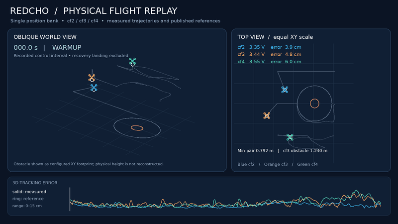

# Single-position REDCHO hardware baseline

This separate ROS 2 Jazzy package controls cf2, cf3 and cf4 using **one order-2 position REDCHO bank per aircraft**. It retains the reference generator, battery governor, formation-shape clock, mission sequence, measurements, landing recovery, stage LEDs, CSV recording and live plots. Version 0.3.0 adds receding visibility-waypoint routes around peers and obstacles to the predictive HOCBF checks, speed/slew anticipation, adaptive pacing and passing fallback. Existing dual-bank packages, launchers and profiles are unchanged.

This is an offboard controller: each ROS agent owns its estimator and QP. Aircraft receive position + yaw commands and execute the existing onboard PID/Kalman/BVCA stack. This snapshot has offline/DDS evidence; a clean physical flight of the final snapshot is not claimed.

See [ROBUST_AVOIDANCE.md](ROBUST_AVOIDANCE.md) for the current avoidance design and validation. [VALIDATION.md](VALIDATION.md) records the earlier unenhanced single-bank baseline; those historical results do not describe the current revision.

See [MATHEMATICAL_FORMULATION.md](MATHEMATICAL_FORMULATION.md) for the complete implementation equations, units, numerical updates, stage logic, hard/soft constraints and limits of the safety and consensus claims. Current route validation is in [the route validation report](../../docs/single-position/historical-route-validation.md).

Use the [repository starting guide](../../docs/single-position/START_HERE.md) for portable installation and complete commands. Original workstation paths below describe the source layout; the repository wrapper uses `config/local/`. The current snapshot also includes scoped Ctrl+C cleanup and duplicate-backend startup protection.

## Real flight data replay



User-provided real flight data replay for **cf2, cf3 and cf4**, showing measured trajectories and published references. The recorded control interval is shown; **recovery landing is excluded**. The obstacle is displayed as its configured XY footprint; its physical height is not reconstructed.

[Replay details](../../docs/single-position/REAL_FLIGHT_REPLAY.md).

## Hardware recordings

- [Motive View.mp4 — original motion-capture view](https://github.com/khubaib007/Safe-Redcho-Crazyflies/releases/download/single-position-v0.3.0/Motive-View.mp4)
- [Live stream.MOV — original camera recording](https://github.com/khubaib007/Safe-Redcho-Crazyflies/releases/download/single-position-v0.3.0/Live-stream.MOV)

Both recordings are preserved unchanged as downloadable release assets. The
live recording was supplied as `.MOV`, rather than `.mp4`.
[Recording details](../../docs/single-position/HARDWARE_VIDEOS.md).

## Architecture

Battery voltage changes each local trajectory phase. The same acquisition/forward SVFs generate displacement, velocity, acceleration and jerk. Each agent supplies its absolute position proposal plus its first two derivatives to one position bank:

```text
battery -> reference phase -> SVFs -> [absolute position, velocity, acceleration]
                                               |
                                    position REDCHO (order 2)
                                               |
                                 [shared position, velocity, acceleration]
                                               |
                              add own formation offset and derivatives
                                               |
                                virtual-reference PD/feedforward
                                               |
                              visibility-route nominal guidance
                                               |
                              local hard HOCBF-QP -> position + yaw
```

During WARMUP, agents exchange bank estimates but hold their individual hover anchors. HEIGHT uses the bank's vertical position/velocity/acceleration. YAW aligns heading. FORMATION/SETTLE/FORWARD/STOP use bank position, velocity and acceleration on all three axes; horizontal formation offsets and their derivatives are added separately. There is no independent velocity REDCHO bank, no velocity-bank state and no velocity-bank neighbor payload.

The single bank has 9 internal scalar states per aircraft (three orders x three coordinates). Each neighbor message exchanges one 3-vector instead of two; this does not imply half the total DDS/radio traffic. Control frames, diagnostics and position commands remain. The position bank's derivative channels are estimator outputs, not finite differences of noisy mocap.

## Files and isolation

- ROS namespace: `/safe_redcho_single_mission`.
- Profiles: `config/single_mission.yaml`, `single_mission_combined.yaml`, `single_mission_obstacle.yaml`, `single_mission_interagent.yaml` at the workspace root.
- Synthetic fixtures: `config/single_mission_{combined,obstacle,interagent}_fixture.yaml`.
- Observer settings: `config/single_mission_{telemetry,liveplots,onboard}.yaml`.
- New survey pointers: `config/generated_single_hocbf/<scenario>.yaml`.
- Immutable captured starts/profiles: `results/single_mission_surveys/<survey-id>/`.
- Generated observer bindings: `config/generated_single_observers/<profile-hash>/`.
- Backend output: `config/generated_single_mission/`.
- Run output: `results/single_mission_<scenario>_<mode>_<time>/`.
- Build/install/log: `build_single_position`, `install_single_position`, `log_single_position`.

Radio URIs and lab calibration are read from the existing `config/fleet_redcho.yaml` and `config/lab_config.yaml`; they are not overwritten. No captured starts from the existing implementation are reused. A new ground survey is required even for the default scenario. The baseline is standalone relative to other first-party controllers; it depends on the same Crazyswarm2/mocap backends.

Run one flight stack at a time: physical `/cf*/cmd_position` topics, radios, backend, mocap and aircraft are shared. Namespace isolation does not permit simultaneous controllers on the same aircraft. The command-publisher/subscriber guards remain active.

## Build without changing the existing install overlay

Start in a clean terminal. Use the installed ROS 2 Jazzy and existing hardware dependencies:

```bash
cd ~/safe_redcho_hardware
set +u
export PYTHONNOUSERSITE=1
source /opt/ros/jazzy/setup.bash
source install/local_setup.bash
/usr/bin/colcon --log-base log_single_position build \
  --build-base build_single_position \
  --install-base install_single_position \
  --packages-select safe_redcho_single_mission
source install_single_position/local_setup.bash
```

The new runner sources the existing hardware environment and this additional overlay. The old launchers continue using their original package and overlay.

## Offline screening

No ROS graph, radio or flight commands are started by `offline`:

```bash
cd ~/safe_redcho_hardware
bash scripts/redcho_single_mission.sh default offline
bash scripts/redcho_single_mission.sh combined offline
bash scripts/redcho_single_mission.sh obstacle offline
bash scripts/redcho_single_mission.sh interagent offline
```

To specify unequal synthetic voltages, use the numerical module directly:

```bash
PYTHONNOUSERSITE=1 PYTHONPATH=src/safe_redcho_single_mission \
  /usr/bin/python3 -s -m safe_redcho_single_mission.preview \
  --config config/single_mission_combined.yaml \
  --starts config/single_mission_combined_fixture.yaml \
  --voltages 3.55 3.45 3.35 \
  --output results/single_position_combined_unequal_manual
```

Synthetic fixtures are numerical examples, not aircraft starts. PASS only describes the specified synthetic tracking model and inputs. It is not a guarantee of flight safety or an obstacle-routing solution.

## Hardware command sequence

Use the same scenario in every terminal; the example below selects `combined`. Replace it with `default`, `obstacle` or `interagent` consistently.

1. With aircraft grounded and control processes stopped, start mocap:

```bash
bash scripts/redcho_single_mission.sh combined mocap
```

2. In another terminal, capture stationary aircraft and obstacle poses, then preview the captured plan:

```bash
bash scripts/redcho_single_mission.sh combined capture
bash scripts/redcho_single_mission.sh combined preview
```

The capture locks the survey, records timestamp/rate/stability evidence, and atomically publishes a separate immutable profile. Changing a source profile, surveyed starts or immutable profile invalidates it. Capture again after moving aircraft/obstacles or changing configuration. Stop standalone mocap after a successful survey/preview.

3. Start the backend in terminal A:

```bash
bash scripts/redcho_single_mission.sh combined backend
```

4. Start three estimator/QP agents and independent watchdog in terminal B:

```bash
bash scripts/redcho_single_mission.sh combined agents
```

5. Start four CSV recorders, live event capture and seven plot windows in terminal C:

```bash
bash scripts/redcho_single_mission.sh combined observe
```

The position REDCHO window includes position, velocity and acceleration input/output and convergence panels. There is no velocity REDCHO window because that estimator does not exist. Other windows cover flight, battery, timing, reference, control and HOCBF. For lighter drawing while keeping recorders:

```bash
bash scripts/redcho_single_mission.sh combined observe reference:=false control:=false hocbf:=false
```

The observers are bound to the exact same immutable profile as the agents, including its hash. They do not silently use the default scenario. Onboard optional log mappings remain disabled by default.

6. Run the ground-only readiness check in terminal D:

```bash
bash scripts/redcho_single_mission.sh combined doctor
bash scripts/redcho_single_mission.sh combined check
```

`doctor` checks software/interfaces locally. `check` uses the backend and agents but never arms, takes off, streams position commands or lands. It includes measured preflight checks, firmware-parameter cache checks and numerical captured-plan screening. Cache agreement is not fresh RF readback.

7. The following are explicit **physical flight commands**, for operator-supervised commissioning after successful screening:

```bash
# Formation acquisition followed by landing:
bash scripts/redcho_single_mission.sh combined acquire

# Full formation acquisition + forward transport + landing:
bash scripts/redcho_single_mission.sh combined fly
```

No physical flight command was run while developing this package. Continue with acquisition-only commissioning before the full mission. Keep backend, agents and watchdog alive through recovery; verify touchdown and disarm before stopping them. Do not start another controller or change firmware/configuration in flight.

## Constraints and recovery

Safety rows remain hard, without safety slack: reciprocal XY pair separation, inflated walls/floor/ceiling and inflated stationary cylinder obstacles. Acceleration and next-step velocity bounds remain hard and componentwise. Ordinary acceleration slew is relaxable only under the existing explicit policy and hard safety-slew cap. Formation tracking remains the objective. No command is accepted without complete same-cycle peer results, local row/bound checks, joint pair verification and held-path checks.

Mocap/onboard freshness and alignment, battery, measured separation, tracking tube, measured speed/tilt, obstacle movement, publication gaps and watchdog checks remain. Missing/nonfinite data, malformed peers or rejected QP commands cannot be replaced by fabricated values. Flight exceptions enter the existing controlled recovery flow; disarm requires verified ground evidence. Journal failures, including final writer/close failures, prevent a PASS result.

The existing physical/virtual separation, obstacle inflation, speed, acceleration and safety-slew cap are not loosened. Enhanced profiles select HOCBF gains 2/2 and explicitly enable safety-priority slew with the existing 8 m/s³ hard cap. The combined nominal formation duration is 15 seconds; adaptive pacing and settling can extend it. These are reference-plant constraints with tracking margins; onboard tracking and the physical stop path still require measured commissioning. A feasible QP at one step is not a proof of recursive feasibility.

## Tests and paper comparison

```bash
cd ~/safe_redcho_hardware
PYTHONNOUSERSITE=1 PYTHONDONTWRITEBYTECODE=1 \
PYTHONPATH=src/safe_redcho_single_mission QT_QPA_PLATFORM=offscreen \
  /usr/bin/python3 -s -m pytest src/safe_redcho_single_mission/test \
  -q -p no:cacheprovider
```

The tests include actual adapter classes with ROS test doubles, estimator/derivative provenance, invalid peer packets, same-cycle barriers, stale measurements, QP safety/slew behavior, landing recovery, survey tamper rejection, observer profile binding, plotting and a complete synthetic mission. Two inherited ZIP-installer tests are skipped because that legacy distribution bundle is not used by this package.

For ablation, compare with the dual-bank controller using identical starts, measured obstacle geometry, battery inputs, mission durations, reference filters, gains and QP settings. The initial baseline copied the corresponding existing scenario parameters and removed only the unused `velocity_L`. The current enhanced profiles additionally change HOCBF gains, pacing/passing options, slew priority and the combined nominal formation duration. The baseline's horizontal velocity/acceleration now come from position-bank derivative outputs. For an architecture-only ablation, use the frozen pre-enhancement checkpoint at `results/checkpoints/single_position_before_avoidance_20261102` or restore its parameters and disable the optional enhancements. Do not attribute enhanced-versus-original differences solely to the number of REDCHO banks.

Report centre/formation error, derivative reconstruction error, minimum separation, QP interventions, deadline misses, runtime and bandwidth separately. Offline PASS does not establish that the single or dual architecture performs better. Keep complete configurations, immutable survey evidence, traces and failures alongside the results.

## Troubleshooting

- **Missing baseline overlay/package:** build `install_single_position`, then use the new runner; do not delete the existing install tree.
- **No ground survey / source changed:** stop control processes, leave aircraft grounded, run mocap and capture again for the selected scenario.
- **Observer hash mismatch:** stop old observers and use this runner's `observe` mode; do not disable hash validation.
- **Competing command publisher:** stop the other mission/controller after verified landing. The new namespace does not separate aircraft command topics.
- **Hard QP failure / blocked goal:** inspect `preview_failure.json`, row CSV and configured geometry. Reposition and recapture or design a valid route; do not reduce safety reserves just to pass.
- **Crossing routes / obstacle detour:** enhanced profiles enable `avoidance.route_guidance`. The nominal controller searches a finite visibility graph around inflated peer/obstacle disks, replans as targets/peers move, and returns to the current REDCHO target when its direct segment clears. `avoidance.route` reports waypoints, search time and blocked reasons. An occupied goal uses the existing passing fallback; neither branch can override hard QP checks.
- **SciPy/NumPy or Qt errors:** use system Python with `-s`/`PYTHONNOUSERSITE=1` and the installed ROS/NumPy/SciPy/pyqtgraph dependencies. Qt5/Qt6 enum handling is included.
- **Physical qualification:** repeat measured timing, tracking, battery and landing checks for this new baseline. The previous dual-bank flights are not validation flights for this controller.
